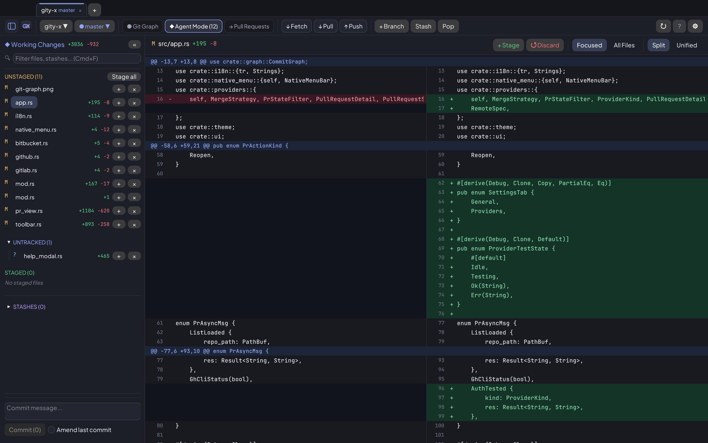
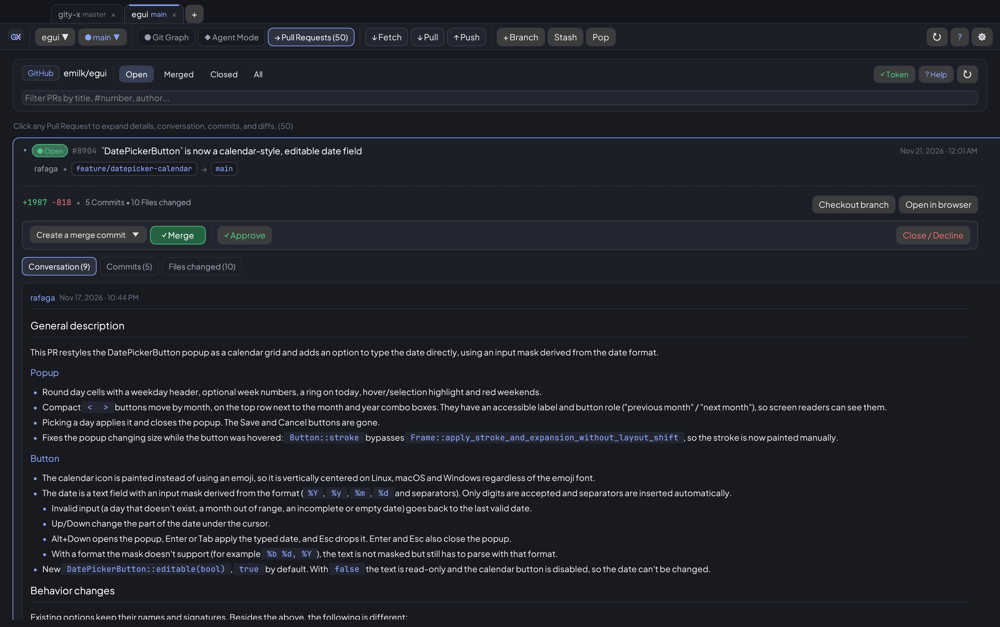
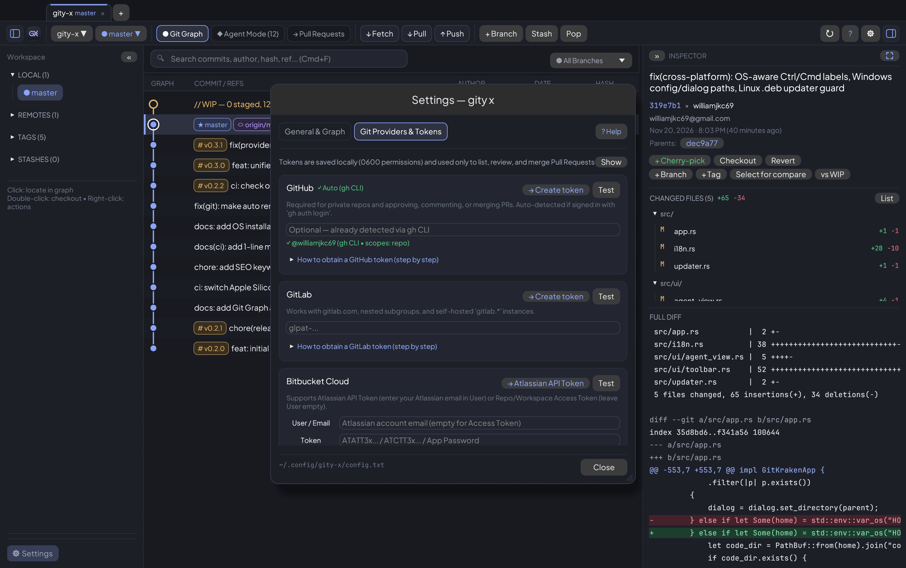
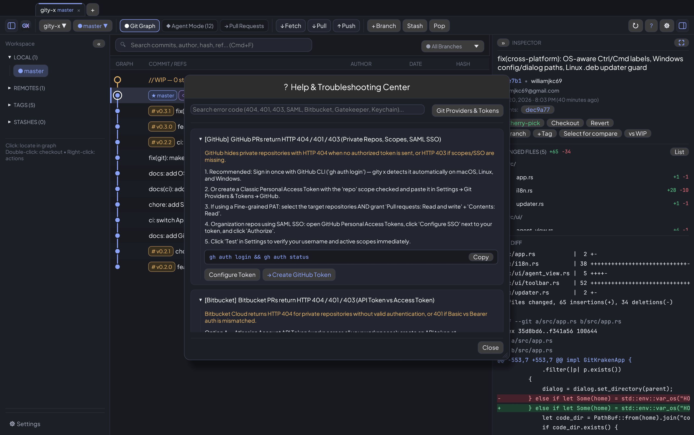

<div align="center">
  
  <h1>gity x</h1>
  <p><strong>Fast, lightweight, cross-platform Git GUI & Pull Request client built in Rust</strong></p>
  <p>Inspired by GitKraken, VS Code Git Graph, and Antigravity's minimalist dark UI.</p>
  <p>
    
    
    
    
  </p>
</div>

---

## Preview

### Git Graph Mode
Visual commit tree with multi-colored Bézier/Angular lanes, branch/tag badges, Chrome-style multi-repo tabs, per-column hover tooltips, and commit diff inspector.


### Agent Mode (Maximized Working Changes)
Full-width review for Unstaged, Untracked, Staged files, and Stashes with Split (Side-by-Side) and Unified diffs, Focused/All Files views, and inline quick-commit.



### Unified Pull Requests (GitHub, GitLab & Bitbucket)
Identical GitHub-style collapsible PR list regardless of Git provider — click any PR to expand rendered **Markdown** descriptions/comments, **Commits**, **Files changed** patches, **Approve / Request changes / Comment**, **Close / Decline / Reopen**, **Checkout branch**, and **Merge** with strategy selector (`Merge commit`, `Squash and merge`, `Rebase and merge`).



### Settings — Git Providers & Token Verification
Structured tabbed Settings with built-in step-by-step guides to obtain tokens for GitHub (including automatic `gh CLI` detection), GitLab, and Bitbucket Cloud, plus 1-click live `Test` authentication verification and local `0600` storage.



### Help & Troubleshooting Center
Built-in searchable Help Center (English & Español) with verified solutions, copyable commands, and direct links for HTTP 401/403/404 token issues, SAML SSO, Bitbucket API vs Access Tokens, macOS Gatekeeper, Keychain prompts, and Git conflicts.



---

## Features

- **Visual Git Commit Graph**: Color-coded lanes, Rounded (Bézier) & Angular edge styles, `HEAD` ring, distinct merge nodes, `WIP` row, and branch/remote/tag badges.
- **Per-Column Contextual Tooltips**: Hover over Graph, Commit/Refs, Author (initials avatar, stats, committer, co-authors & GPG/SSH signature status), Date (human-formatted), or Hash (full SHA-1).
- **Agent Mode (Maximized Working Changes)**: Full-width review for Unstaged, Untracked, Staged files, and Stashes with **Split (Side-by-Side)** and **Unified** diffs.
- **Unified Pull Requests / Merge Requests (`GitHub`, `GitLab`, `Bitbucket`)**:
  - Auto-detects provider from `git remote origin` (SSH & HTTPS, nested GitLab groups, self-hosted `gitlab.*` & GitHub Enterprise)
  - Clean collapsible PR list (`Open` / `Merged` / `Closed` / `All`) with instant search and lazy detail loading
  - Automatic **Markdown** rendering for PR descriptions & comments (headings, fenced code blocks, tables, task checklists, blockquotes, inline code, clickable links)
  - Review & lifecycle actions: **Approve**, **Request changes**, **Comment**, **Close / Decline**, **Reopen**, **Checkout branch**, **Open in browser**
  - Unified **Merge** strategy selector across providers: **Merge commit**, **Squash and merge**, and **Rebase / Fast-forward merge**
  - Auto-detects `gh auth token` on macOS (including Finder `.app` bundles), Linux, and Windows, plus live `Test` token verification in Settings
- **Automatic In-Place App Updates**:
  - Checks GitHub Releases once on startup (0% idle CPU, toggleable in Settings)
  - Downloads platform update archive (`.tar.gz` on macOS, `.exe` on Windows, `.AppImage` on Linux), verifies **SHA-256** against `SHA256SUMS.txt`, swaps the bundle/binary atomically, and offers 1-click restart — no manual `.dmg` reinstall needed
- **Chrome-Style Multi-Repo Tabs**: Open multiple repositories simultaneously with `O(1)` memory footprint (inactive tabs store metadata only) and 0% idle CPU.
- **Complete Git Operations**:
  - Cherry-pick, Revert, Checkout, Merge (normal & `--no-ff`), Rebase, Reset (`--soft` / `--mixed` / `--hard`)
  - Conflict banner with Continue / Abort for Merge, Rebase, and Cherry-pick
  - Searchable branch switcher dropdown + Create Branch From (HEAD, local, remote, tag, or commit) + Rename / Force Delete (`-D`)
  - Compare any 2 commits or compare commit vs Working Tree (`vs WIP`)
  - Changed files in Tree or Flat list view with `+add -del` stats
  - Tags (create lightweight/annotated, push, delete) and Stashes (save with message, preview diff, apply, pop, drop)
  - Opt-in lightweight remote update indicator (`git ls-remote`, zero polling, no macOS Keychain popup spam)
- **Polished Cross-Platform UX**:
  - Embedded **Plus Jakarta Sans** & **JetBrains Mono** typography
  - Collapsible left & right sidebars with custom deterministic resize splitter
  - Humanized Error Modal with exact API/Git diagnostics, 1-click Copy, and direct **Troubleshoot** button
  - Built-in **Help & Troubleshooting Center** (`?` button or Help menu)
  - Stacked bottom-right floating success toasts (5s auto-dismiss)
  - OS-aware shortcut hints (`Cmd` on macOS, `Ctrl` on Windows/Linux) + English (default) & Español i18n persisted locally (`~/.config/gity-x/config.txt` or `%APPDATA%\gity-x\config.txt`)

## Keyboard Shortcuts

| Shortcut | Action |
| :--- | :--- |
| `Cmd/Ctrl + O` or `Cmd/Ctrl + N` | Open repository in new tab |
| `Cmd/Ctrl + W` | Close active tab |
| `Cmd/Ctrl + 1..9` / `Ctrl + Tab` | Switch repository tabs |
| `Cmd/Ctrl + E` | Toggle **Git Graph** / **Agent Mode** |
| `Cmd/Ctrl + P` | Toggle **Pull Requests** mode |
| `Cmd/Ctrl + R` | Refresh repository & pull requests |
| `Cmd/Ctrl + F` | Focus search / filter |
| `Cmd/Ctrl + B` | Toggle left sidebar |
| `Cmd/Ctrl + I` | Toggle right inspector |
| `Cmd/Ctrl + ,` | Open Settings |
| `Cmd/Ctrl + /` | Open Keyboard Shortcuts |
| `Esc` | Close active modal |

## Build & Run from Source

### Prerequisites

- [Rust](https://rustup.rs/) (stable toolchain)
- `git` available in `PATH`

### Run

```bash
git clone https://github.com/williamjkc69/gity-x.git
cd gity-x
cargo run --release
```

You can also pass a repository path directly:

```bash
cargo run --release -- /path/to/your/repo
```

## Installation Guide

Prebuilt binaries for **macOS (Apple Silicon & Intel)**, **Windows**, and **Ubuntu / Linux** are published in **[GitHub Releases](https://github.com/williamjkc69/gity-x/releases)**.

> **100% Open Source & Malware-Free**
> `gity x` contains **zero malware, zero telemetry, and zero tracking**. Every release binary is compiled directly from this public source code via [GitHub Actions](.github/workflows/release.yml) with verifiable `SHA256SUMS.txt` checksums.
>
> **Why does macOS or Windows show a security warning?**
> Because `gity x` is a free indie open-source project without a paid Apple Developer ID ($99/yr) or Windows Code Signing certificate yet, macOS Gatekeeper (*"Apple could not verify..."*) and Windows SmartScreen (*"Windows protected your PC"*) warn on unsigned apps by default. This does **not** mean malware was detected — see [SECURITY.md](SECURITY.md) or compile from source anytime.

---

### macOS (Apple Silicon M1–M4 & Intel)

#### Option 1 — Quick 1-Line Install (Recommended, no warning)
Detects Apple Silicon (`arm64`) or Intel (`x64`), downloads the latest `.dmg`, installs to `/Applications`, and clears the browser quarantine flag automatically:

```bash
curl -fsSL https://raw.githubusercontent.com/williamjkc69/gity-x/master/scripts/install-macos.sh | bash
```

Once installed (`v0.3.0+`), future releases **auto-download and update in place** without needing to re-install `.dmg` files or clear Gatekeeper again.

#### Option 2 — Manual `.dmg` Download
1. Download `gity-x-vX.Y.Z-macos-arm64.dmg` (Apple Silicon) or `gity-x-vX.Y.Z-macos-x64.dmg` (Intel) from [Releases](https://github.com/williamjkc69/gity-x/releases).
2. Open the `.dmg` and drag **gity x.app** into **Applications**.
3. If macOS displays *"Apple could not verify 'gity x.app' is free of malware"*:
   - **Via Terminal (fastest)**:
     ```bash
     xattr -cr "/Applications/gity x.app"
     ```
     Then open **gity x** normally from Applications or Spotlight.
   - **Via System Settings (no terminal)**:
     1. Click **Done** (do **not** click *Move to Trash*).
     2. Open **System Settings → Privacy & Security**.
     3. Scroll down to the **Security** section and click **Open Anyway** next to `"gity x.app" was blocked`.
     4. Confirm with your Mac password or Touch ID.

---

### Windows (10 / 11 — x64)

1. Download `gity-x-vX.Y.Z-windows-x64.exe` from [Releases](https://github.com/williamjkc69/gity-x/releases).
2. Make sure [Git for Windows](https://git-scm.com/download/win) is installed and available in `PATH`.
3. Place `gity-x.exe` in a writable folder (e.g. `%LocalAppData%\Programs\gity-x`) and double-click to launch (supports automatic in-place updates).
4. If **Windows Defender SmartScreen** shows *"Windows protected your PC"*:
   1. Click **More info**.
   2. Click **Run anyway**.

---

### Ubuntu / Debian / Linux (x64)

Make sure `git` is installed (`sudo apt install git`). Linux does not show Gatekeeper/SmartScreen blocks.

#### Option 1 — Universal Linux AppImage (`.AppImage` — supports auto-updates)
```bash
chmod +x gity-x-v*-linux-x86_64.AppImage
./gity-x-v*-linux-x86_64.AppImage
```

#### Option 2 — Ubuntu / Debian Package (`.deb`)
```bash
sudo apt install ./gity-x-v*-linux-amd64.deb
```
Launch **gity x** from your Applications menu or run `gity-x` in a terminal.

---

### Verify Download Integrity (Optional)

Every release includes `SHA256SUMS.txt` (also verified automatically during in-app auto-updates):

```bash
# macOS
shasum -a 256 gity-x-v*-macos-*

# Linux
sha256sum gity-x-v*-linux-*

# Windows (PowerShell)
Get-FileHash .\gity-x-v*-windows-x64.exe -Algorithm SHA256
```

---

### Creating a New Release Version (Maintainers)

Push any semantic version tag (`vX.Y.Z`) to automatically build and publish macOS `.dmg` & `.tar.gz` (arm64 + x64), Windows `.exe`, Linux `.deb` & `.AppImage`, and `SHA256SUMS.txt` via GitHub Actions:

```bash
git tag -a v0.3.2 -m "Release v0.3.2"
git push origin v0.3.2
```

### Build Local macOS `.dmg` & `.tar.gz`

```bash
./scripts/package-macos.sh 0.3.2
# Output: dist/gity-x-v0.3.2-macos-arm64.dmg & .tar.gz
```

## Author

Created by **[@williamjkc69](https://github.com/williamjkc69)**.

## License

MIT — see [LICENSE](LICENSE).
