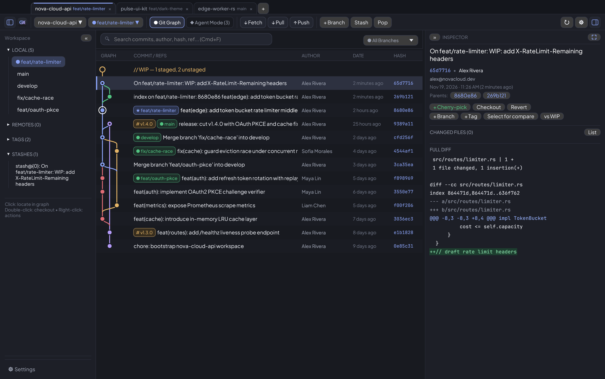

<div align="center">
  
  <h1>gity x</h1>
  <p><strong>Fast, lightweight, cross-platform Git GUI built in Rust</strong></p>
  <p>Inspired by GitKraken, VS Code Git Graph, and Antigravity's minimalist dark UI.</p>
  <p>
    
    
    
  </p>
</div>

---

## Preview

### Git Graph Mode
Visual commit tree with multi-colored Bézier lanes, branch/tag badges, multi-repo tabs, per-column hover tooltips, and commit diff inspector.



### Agent Mode (Maximized Working Changes)
Full-width review for Unstaged, Untracked, Staged files, and Stashes with Split (Side-by-Side) and Unified diffs.


---

## Features

- **Visual Git Commit Graph**: Color-coded lanes, Rounded (Bézier) & Angular edge styles, `HEAD` ring, distinct merge nodes, `WIP` row, and branch/remote/tag badges.
- **Per-Column Contextual Tooltips**: Hover over Graph, Commit/Refs, Author (with initials avatar, commit stats, committer, co-authors & GPG/SSH signature status), Date (human-formatted), or Hash (full SHA-1).
- **Agent Mode (Maximized Working Changes)**: Dedicated full-width review for Unstaged, Untracked, Staged files, and Stashes with **Split (Side-by-Side)** and **Unified** diffs.
- **Chrome-Style Multi-Repo Tabs**: Open multiple repositories simultaneously with `O(1)` memory footprint (inactive tabs store metadata only) and 0% idle CPU.
- **Complete Git Operations**:
  - Cherry-pick, Revert, Checkout, Merge (normal & `--no-ff`), Rebase, Reset (`--soft` / `--mixed` / `--hard`)
  - Conflict banner with Continue / Abort for Merge, Rebase, and Cherry-pick
  - Searchable branch switcher dropdown + Create Branch From (HEAD, local, remote, tag, or commit) + Rename / Force Delete (`-D`)
  - Compare any 2 commits or compare commit vs Working Tree (`vs WIP`)
  - Changed files in Tree or Flat list view with `+add -del` stats
  - Tags (create lightweight/annotated, push, delete) and Stashes (save with message, preview diff, apply, pop, drop)
  - Lightweight Fetch / Pull / Push indicators (`git ls-remote` one-shot check, zero polling)
- **Polished UX**:
  - Embedded **Plus Jakarta Sans** & **JetBrains Mono** typography
  - Collapsible left & right sidebars with custom deterministic resize splitter
  - Humanized Error Modal with full raw output & 1-click Copy for debugging
  - Stacked bottom-right floating success toasts (5s auto-dismiss)
  - Native OS menu bar + English (default) & Español i18n persisted in `~/.config/gity-x/config.txt`

## Keyboard Shortcuts

| Shortcut | Action |
| :--- | :--- |
| `Cmd/Ctrl + O` or `Cmd/Ctrl + N` | Open repository in new tab |
| `Cmd/Ctrl + W` | Close active tab |
| `Cmd/Ctrl + 1..9` / `Ctrl + Tab` | Switch repository tabs |
| `Cmd/Ctrl + E` | Toggle **Git Graph** / **Agent Mode** |
| `Cmd/Ctrl + R` | Refresh repository & check remote updates |
| `Cmd/Ctrl + F` | Focus search / filter |
| `Cmd/Ctrl + B` | Toggle left sidebar |
| `Cmd/Ctrl + I` | Toggle right inspector |
| `Cmd/Ctrl + ,` | Open Settings |
| `Cmd/Ctrl + /` | Open Keyboard Shortcuts |
| `Esc` | Close active modal |

## Build & Run from Source

### Prerequisites

- [Rust](https://rustup.rs/) (stable toolchain)
- `git` available in `PATH`

### Run

```bash
git clone https://github.com/williamjkc69/gity-x.git
cd gity-x
cargo run --release
```

You can also pass a repository path directly:

```bash
cargo run --release -- /path/to/your/repo
```

## Downloads (macOS, Windows, Ubuntu / Linux)

Prebuilt installers are published automatically on every release tag in **[GitHub Releases](https://github.com/williamjkc69/gity-x/releases)**:

- **macOS (Apple Silicon / Intel)**: `gity-x-vX.Y.Z-macos-arm64.dmg` / `gity-x-vX.Y.Z-macos-x64.dmg`
- **Windows (x64)**: `gity-x-vX.Y.Z-windows-x64.exe`
- **Ubuntu / Debian**: `gity-x-vX.Y.Z-linux-amd64.deb` (`sudo apt install ./gity-x-*.deb`)
- **Linux Universal**: `gity-x-vX.Y.Z-linux-x86_64.AppImage` (`chmod +x *.AppImage && ./gity-x-*.AppImage`)

### Creating a New Release Version

Push any semantic version tag (`vX.Y.Z`) to automatically build and publish `.dmg`, `.exe`, `.deb`, and `.AppImage` via GitHub Actions:

```bash
git tag -a v0.2.1 -m "Release v0.2.1"
git push origin v0.2.1
```

### Build Local macOS `.dmg`

```bash
./scripts/package-macos.sh 0.2.1
# Output: dist/gity-x-v0.2.1-macos-arm64.dmg
```

## Author

Created by **[@williamjkc69](https://github.com/williamjkc69)**.

## License

MIT — see [LICENSE](LICENSE).
